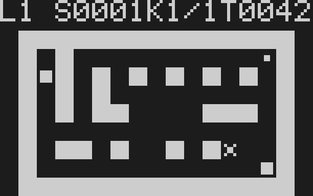
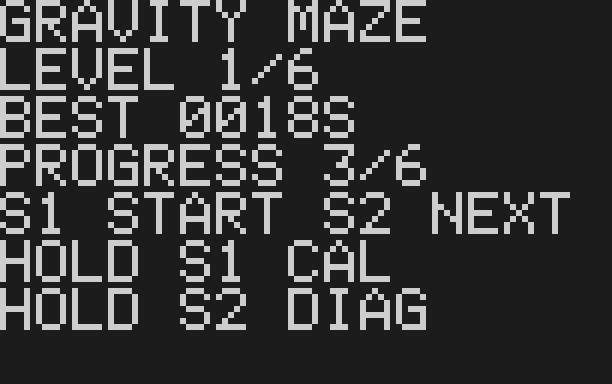
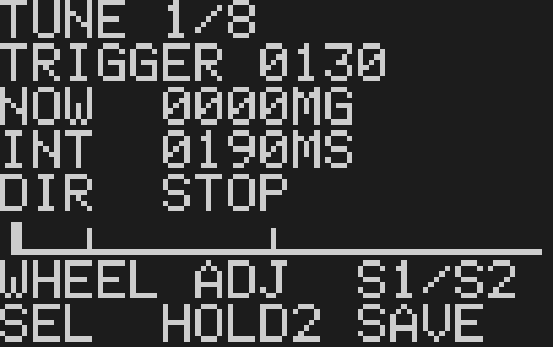
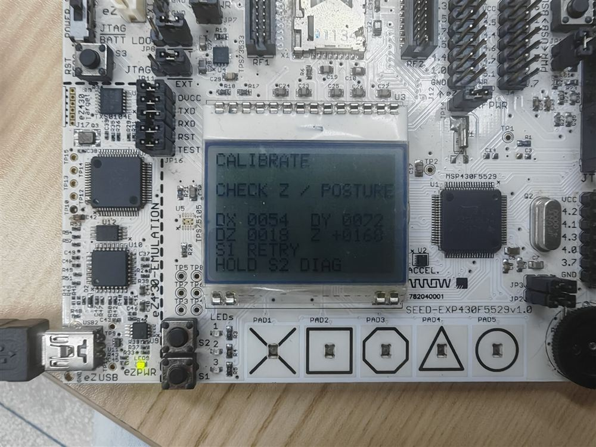
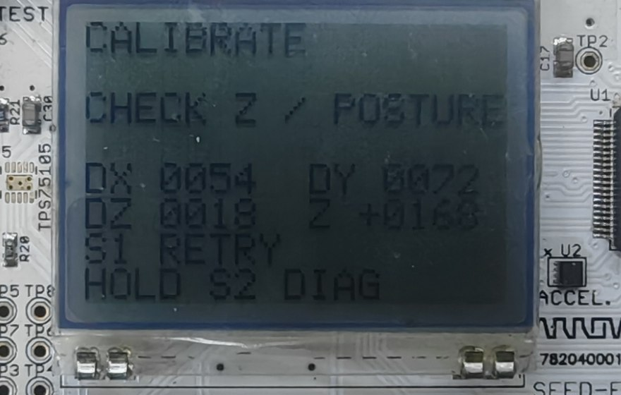

# GravityMaze · MSP430F5529 重力感应迷宫

> 一块不到 50 元的单片机开发板，做成一台**用倾斜玩的弹珠迷宫**：歪板子走迷宫、捡钥匙开门、躲陷阱计时通关。

用板载加速度传感器感知倾斜，在 102×64 黑白点阵屏上逐格移动；6 关顺序解锁，最佳成绩与解锁进度断电保存；手感参数可以**转板上的拇指滚轮现场调**，不用重新烧录。



<table>
<tr>
<td></td>
<td></td>
</tr>
<tr>
<td align="center">菜单：关卡 / 最佳成绩 / 解锁进度</td>
<td align="center">TUNE：转滚轮调参数，实时看倾角与间隔</td>
</tr>
</table>

> 以上为程序帧缓冲的真实渲染（102×64，按面板深底亮字的显示方式绘制），非示意图。

<p align="center">
  
</p>

## 特性

- **倾斜控制**：校准 + 低通滤波 + 阈值回差 + 单轴判定，手感干净不乱飘
- **倾角调速**：轻歪 190 ms/格便于精细走位，猛歪 90 ms/格快速赶路
- **6 关迷宫**：能量点捡齐才开门、陷阱退回起点罚时 3 秒、顺序解锁
- **断电存档**：INFO C/D 双副本 + 序号 + 校验和，写到一半断电也只丢最近一次
- **TUNE 调试台**：转滚轮调 7 个灵敏度参数，实时显示倾角与每格间隔，参数存 INFO B
- **诊断页**：加速度计原始计数、寄存器、SPI 状态一目了然
- **PC 自动化测试**：核心逻辑脱离硬件，20 个套件在主机全绿后才上板

## 硬件

| 部件 | 说明 |
|---|---|
| 主控 | MSP430F5529（64 KB Flash / 8 KB RAM） |
| 开发板 | SEEED-EXP430F5529 V1.0（兼容 TI MSP-EXP430F5529） |
| 传感器 | 板载 CMA3000-D01 或 LIS3DH（自动识别） |
| 显示 | DOGS102 102×64 点阵，SPI |
| 输入 | S1/S2 按键 + 模拟拇指轮（电位器，P6.5/ADC-A5） |
| 存储 | 片内 INFO Flash（B 存调参，C/D 存进度） |
| 工具链 | TI CCS 5.5 / MSP430 编译器 4.2.x，C89 |

引脚映射见 [硬件资源与引脚映射](docs/hardware_mapping.md)。

## 快速开始

```text
1. 克隆仓库到短路径（如 D:\GravityMaze），避免中文/超长路径
2. CCS → Project → Import Existing CCS Projects → 选择仓库根目录
3. 若提示编译器版本不符，在 Properties → General 选择本机已装的 TI MSP430 4.2.x
4. Project → Build → Debug/Download
5. 板子平放，短按 S1，松手静置约 2.3 秒完成校准
6. 进入菜单，短按 S1 开始游戏，倾斜板子移动
```

详细步骤（导入失败恢复、擦除信息内存、常见报错）见 [CCS 导入与编译](docs/ccs_setup.md) 和 [首次上板](docs/bringup.md)。

## 操作

| 界面 | 短按 S1 | 短按 S2 | 长按 S1 | 长按 S2 |
|---|---|---|---|---|
| 校准 | 开始/重试校准 | — | 返回准备 | 传感器诊断 |
| 菜单 | 开始所选关卡 | 循环选关 | 校准 | 诊断（再长按进 TUNE） |
| 游戏 | 暂停 | 重开本关 | 校准 | 返回菜单 |
| 暂停 | 恢复 | 重开并运行 | 校准 | 返回菜单 |
| 通关 | 下一关 | 重玩本关 | 校准 | 返回菜单 |
| 诊断 | 重新初始化传感器 | 返回菜单 | 校准 | **进入 TUNE** |
| TUNE | 上一参数 | 下一参数 | 不保存返回 | 保存返回 |
| 错误 | 重新初始化 | — | — | — |

长按约 800 ms 触发一次，松手不再补发短按。想自由选关把 `include/app_config.h` 的 `GAME_LEVEL_LOCK` 改为 `0`。

## 玩法

- HUD 一行：`L1 S0032 K1/2 T0042` = 关卡 / 步数 / 剩余能量点 / 秒数
- 能量点 `o` 全捡完，出口 `E` 才从实心（锁）变为空心（开）
- 踩陷阱 `x` 退回起点并罚时 3 秒，屏幕提示 `TRAP! +3S`
- 撞墙不计步、不扣分；通关冻结计时并记录最佳用时/步数

关卡表、界面细节、参数含义见 [游戏玩法](docs/gameplay.md)。

## 灵敏度调试台（TUNE）

菜单长按 S2 → 诊断页 → 再长按 S2 → **转滚轮调当前参数**，S1/S2 切参数，长按 S2 保存。

| 参数 | 默认 | 范围 | 作用 |
|---|---:|---|---|
| TRIGGER | 130 mg | 50–400 | 起步倾角（≈7.5°） |
| RELEASE | 100 mg | 30–300 | 停止倾角（回差 30 mg） |
| MARGIN | 35 mg | 10–120 | 换轴所需领先量 |
| SLOW MS | 190 | 120–400 | 轻歪每格间隔 |
| FAST MS | 90 | 60–250 | 猛歪每格间隔 |
| FULL MG | 450 | 250–1000 | 达到最快的倾角（≈26°） |
| FILTER | 2/4 | 1–3 | 滤波权重，越大越跟手 |

屏幕同时显示滤波后倾角 `NOW`、按当前参数算出的每格间隔 `INT` 和倾角条；选 `DEFAULT` 转一下滚轮恢复默认。参数存 INFO B，掉电保留，与关卡进度互不影响。

## 软件架构

```text
app 状态机（校准/菜单/游戏/暂停/通关/诊断/TUNE/错误）
 ├─ game   地图、走格、钥匙、陷阱、计时、限速
 ├─ input  校准、滤波、方向判定、运行时参数
 ├─ ui     帧缓冲绘制（8 类页面）
 └─ drivers  传感器 SPI / LCD / 按键 / 滚轮 / 定时器 / 信息 Flash
        ↑ 只有这一层碰寄存器，其余层为纯逻辑，可在 PC 上测试
```

- 主循环 + Timer_A 毫秒时基；按键 5 ms 中断扫描、20 ms 消抖、事件队列
- 传感器 20 ms 采样；LCD 100 ms 整帧推送（816 字节帧缓冲）
- 无操作系统、无 `malloc`、无递归；源码约 2300 行 C

详解见 [系统架构](docs/architecture.md)、[状态机](docs/state_machine.md)、[存档系统](docs/save_system.md)。

## 测试

```powershell
pwsh tools/test_host.ps1
```

主机 GCC 以 C89 严格模式（`-Wall -Wextra -Werror -pedantic`）编译同一份源码，硬件用替身模型（内存 Flash、SPI 事务、GPIO 电平、ADC tick）：

- 六关地图"位置×已收集组合"状态空间 BFS 证明可解，再由真实 `game.c` 沿解路线重放校验
- 倾角调速与限速不可绕过、陷阱传送罚时、出口锁定、菜单锁关
- 双副本存档、校验损坏回退、擦除失败不崩溃
- TUNE 参数钳制、INFO B 保存与损坏回退、滚轮调参全流程
- 按键消抖、LCD 帧渲染、应用状态转换、加速度计 SPI 时序

实际输出与覆盖清单见 [验证记录](docs/validation.md)。

## 已知限制

- **未在实物 Z 轴验证通过**：本开发者手上的板子 Z 通道翻面仅约 ±162 mg（正常应 ≈±1000 mg），校准会如实停在 `CHECK Z / POSTURE`。代码**不放宽**判据掩盖硬件问题，排查过程见 [传感器诊断](docs/sensor_diagnostics.md)。

  

  真机现象：`DX 0054 DY 0072 DZ 0018 Z +0168`——Z 幅度明显偏小，校准正确拒绝通过。

- 传感器 X 轴方向因板而异，本工程默认 `MOTION_X_SIGN=-1`，换板请自行确认。
- 计时基于内部 REFO/FLL（约 1.048576 MHz），不是精密秒表。
- 拇指轮是**模拟电位器**而非正交编码器，方向若相反把 `WHEEL_INVERT` 改为 `1`。
- 本仓库在 PC 上完成全部自动化测试；CCS 目标编译与实物手感由使用者在本地验证。

## 文档

完整索引见 [docs/README.md](docs/README.md)（含建议阅读顺序与按角色的阅读路线）。最常看的几篇：

| 文档 | 内容 |
|---|---|
| [项目概述与设计要点](docs/overview.md) | 全貌：目标、框图、已实现与已知限制 |
| [游戏玩法](docs/gameplay.md) | 规则、六关、HUD、TUNE 调试台 |
| [系统架构](docs/architecture.md) | 分层、数据流、时序、内存 |
| [存档系统](docs/save_system.md) | INFO 分区、记录格式、双副本、擦除时序 |
| [首次上板](docs/bringup.md) | 从零到能玩 |
| [调试记录](docs/debug_log.md) | 踩过的坑与结论 |

## 许可证

- 本项目**原创部分**（游戏逻辑、校准/滤波/方向算法、UI、测试）以 MIT 许可证发布，见 [LICENSE](LICENSE)。
- 传感器与 LCD 驱动、字库、CCS 元数据改编自 TI MSP-EXP430F5529 User Experience，沿用原 **BSD 三条款** 许可证，见 [NOTICE_TI.txt](NOTICE_TI.txt)。再分发时请保留原版权声明。

## 贡献者

- **Flame-creator01** — 项目发起、硬件调试与实机验证
- **DSH (DeepSeek Harness)** — 代码实现、自动化测试与文档（AI 助手）

## 致谢

TI MSP-EXP430F5529 User Experience 提供的 HAL 参考实现与硬件资料（SLAU208、SLAU330、器件数据手册）。
