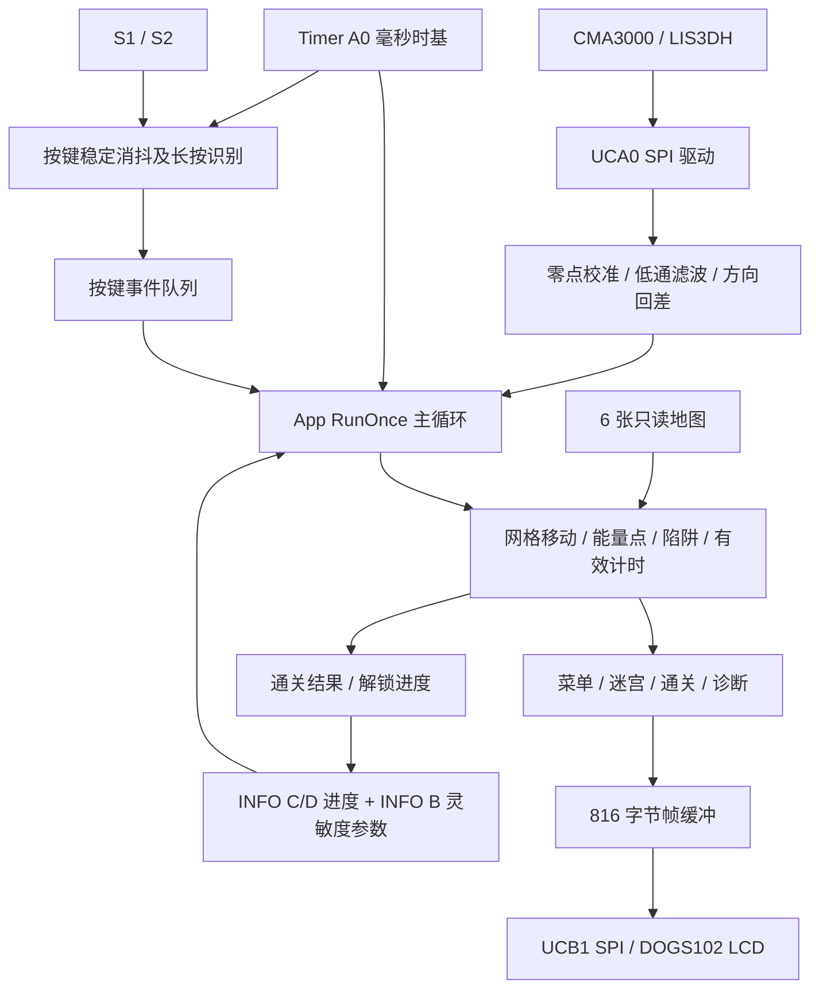

> 返回 [文档索引](README.md)

# 系统架构与模块接口

代码按职责分层：`board` 负责时钟与板级初始化，`drivers` 负责外设访问（LCD、加速度计、按键、滚轮、LED、定时器、信息 Flash），`input` 负责校准/滤波/方向/灵敏度参数，`game` 负责地图与规则，`app` 持有状态机与调试观察变量，`ui` 负责画面绘制。无动态内存，不使用 `malloc`。

## 调度

Timer_A0 中断维护 `uint32_t` 毫秒计数，每 5 次中断读取两个按键并执行消抖与长按识别，将事件放入队列。主循环取出事件，负责传感器采样、状态切换、游戏和显示；中断中不访问 SPI 或绘图。这样 LCD 绘图和整屏发送期间仍能采集按键。读取 32 位时基与取出按键事件时均保存并恢复原 GIE 状态。

| 任务 | 周期 | 说明 |
|---|---|---|
| 按键 | 5ms，中断扫描 | 候选电平连续稳定 20ms 后接受，长按约 800ms |
| 加速度计 | 20ms | 统一 mg；LIS3DH 无新样本返回 WAIT |
| 移动 | 90～190ms，随倾角变化 | 轻倾 190ms、倾角约 450mg 时 90ms，中间线性；首次允许立即移动，方向切换或中立不能绕过限速 |
| 显示 | 100ms | 先在 RAM 画整帧，再通过 SPI 发送；有操作时提前刷新 |

## 按键输入

按键扫描放在定时中断里，而不是主循环：LCD 绘图与整屏传输会延后主循环，旧式主循环轮询存在漏掉短按的可能。当前实现：

- Timer_A0 每 5ms 扫描 S1/S2，显示刷新期间也能扫描；
- 消抖时间为 20ms，短按在稳定松开后触发一次；
- 长按在稳定按下后约 800ms 产生一次，松开后不再产生短按；
- 事件队列共 8 个槽，可容纳 7 个待处理事件；只有定时器中断写入，主循环按序取出；队列满时丢弃新事件、保留已有顺序，不覆盖旧事件。

主循环若延迟取事件，事件仍按产生顺序排队；队列回绕、满、两键同时触发与毫秒计数回绕均有主机测试覆盖。

## 校准

短按 S1 后先静置等待 1000ms，期间继续读取传感器以监测通信，但不纳入校准统计——按键施力带来的振动若被计入，会让校准平白失败。随后收集 64 个有效样本，检查三个轴的峰峰差不超过 120mg、Z 轴均值绝对值在 600～1400mg、X/Y 均值绝对值不超过 600mg。

失败按 S1 重试；界面分别显示波动过大、Z/姿态异常、X/Y 倾斜过大，并显示 DX/DY/DZ 峰峰差和 Z 均值，完整数值可在 CCS 的 `g_debug` 中读取。多个条件同时失败时优先报告波动，再报告 Z，最后报告倾斜；需结合诊断数据排除通信错误。失败页数字宽度为 4 位，极端异常值可能只显示末 4 位。

校准内部依次为 IDLE → SETTLING（等待 1 秒）→ COLLECTING（64 次有效采样）→ OK 或 UNSTABLE。等待与采样中忽略重复 S1 短按（不会重置进度）；长按 S1 返回校准准备并取消本次统计。时间差采用无符号减法，支持毫秒计数回绕。

X/Y 均值为偏置，不保存至 Flash。这些稳定性与姿态阈值是固定的校准判据，不会因传感器读数异常而放宽：读数不满足条件时程序报错并要求排查，而不是降低门槛通过。

## 运动输入

低通滤波权重是运行时可调的 `g_tuning.filter_num`（1～3，对应 1/4、2/4、3/4 新值权重，默认 2/4）：`f = (f*(4-w) + (new-offset)*w) / 4`，中间运算显式使用 32 位。

- 默认 130mg 为触发阈值（约 7.5°）、100mg 为释放阈值（约 5.7°）；
- 两个轴竞争时保留当前轴，另一轴强出 35mg 才切换；
- 滤波后取两轴绝对值较大者作为 `MotionStatus.tilt_mg`，供游戏换算移动间隔（越倾越快）；
- 重新运行会清除旧的滤波方向，避免暂停前的输入导致立即移动。

阈值、滤波权重与速度曲线都在 `g_tuning` 中，可在 TUNE 里调整并保存到 INFO B。轴交换、正负方向只在 `app_config.h` 的 `MOTION_SWAP_XY`、`MOTION_X_SIGN`、`MOTION_Y_SIGN` 修改；当前默认配置为 `MOTION_SWAP_XY=0`、`MOTION_X_SIGN=-1`、`MOTION_Y_SIGN=1`（实物上左右方向以此为准）。

各项默认参数的来历：

| 参数 | 默认 | 历史值 | 调整动机 |
|---|---:|---|---|
| 触发阈值 `MOTION_TRIGGER_MG` | 130mg（≈7.5°） | 220mg（≈12.7°） | 原值日常倾斜下每格约 240～260ms，响应太慢 |
| 释放阈值 `MOTION_RELEASE_MG` | 100mg（≈5.7°） | 150 → 80 → 100mg | 过低会让方向多保持几步，回中后仍有后摇 |
| 轴切换余量 `MOTION_AXIS_MARGIN_MG` | 35mg | 45mg | 45mg 偏保守，换轴迟滞明显 |
| 每格间隔 | 190ms / 90ms | 260ms / 120ms | 配合触发阈值下调，轻倾可对准、重倾可赶路 |
| 满速倾角 `GAME_TILT_FULL_MG` | 450mg（≈26°） | 800mg（≈53°） | 原值日常倾斜到不了满速 |
| 低通滤波权重 `MOTION_FILTER_WEIGHT` | 2/4 | 1/4（时间常数约 60ms） | 1/4 使反向过零与回中衰减偏慢，换向慢、后摇长 |

## 游戏

地图为 15×9 的常量字符网格：墙 `#`、通道空格、能量点 `o`、陷阱 `x`、出口 `E`。每关起点 `(1,1)`、出口 `(13,7)`，共 6 关。`Game_Init()` 扫描地图并记录能量点位置与数量；位置为网格坐标，不进行重力积分或斜向移动。目标格合法且非墙时才更新位置；成功移动才增加步数。

- **能量点**：进入未收集的能量点格时标记已收集并减少剩余数；剩余数不为 0 时进入出口会被拒绝并给出 `NEED KEYS` 提示。
- **陷阱**：进入陷阱格时计一步、退回起点（`GAME_TRAP_RESET=1`）、给有效时间加 3 秒，并产生 1.2 秒的 `TRAP` 提示。
- **移动间隔**：`MoveInterval(tilt_mg)` 在 190ms（≤130mg）与 90ms（≥450mg）之间线性插值，限速仍通过 `last_move` 判断，方向切换或中立不能绕过。
- **通关**：能量点清零后进入出口即通关，冻结计时。`Game_SetRunning()` 明确控制有效时间累计，暂停和通关后停止累计，时间差采用无符号减法应对时基回绕。

## 存档

`SaveData` 保存已解锁关卡数、每关最佳步数与最佳用时。`Save_Load()` 在 `App_Init()` 读取 INFO C/D 两个槽，校验魔数/版本/校验和后取序号较新的有效记录；`Save_Store()` 擦写另一个槽，成功后才切换当前槽，掉电最坏只丢最近一次保存。通关时 `Save_ApplyResult()` 合并成绩与解锁，仅在有变化时写 Flash。详见 [存档系统说明](save_system.md)。

## 灵敏度参数（TUNE）

`source/input/tuning.h/.c` 提供运行时的 7 个参数：触发/释放阈值、轴切换余量、慢速/快速间隔、满速倾角和低通滤波权重。

- `g_tuning` 的静态初值来自 `app_config.h`；
- `App_Init()` 调用 `Tuning_Load()` 从 INFO B（save-port slot 2）载入，并做范围与曲线一致性钳制（释放<触发、快速<慢速、满速>触发、滤波 1～3）；
- TUNE 调试台只修改 `g_tuning`，运动/游戏模块每次直接读取，因此退出调试台立即生效；
- 长按 S2 时 `Tuning_Save()` 写入 INFO B，失败只影响保存，参数在本次上电内仍生效；
- 进度存档（INFO C/D）与调参（INFO B）互不影响。

设计动机是不重新编译、不重新下载就能在现场调手感。早期版本 6 个参数用 S1 短按/长按增减，后来把调值改用板载滚轮，S1/S2 只负责切换参数与保存；滚轮实现见下节。

## 滚轮输入（TUNE 调值）

板载滚轮是模拟拇指轮（电位器），不是正交编码器：P8.0 高电平使能，滑臂接 P6.5/ADC12 A5（TI 参考设计 `HAL_Wheel.c`）。

`source/drivers/wheel.c` 用 ADC12 单通道单次转换读取，按相对位移每 `WHEEL_STEP_ADC`（默认 96）个计数产生一个 tick，`Wheel_Poll()` 返回 −6～+6；因此不需要滚轮绝对位置校准。应用每 20ms 采样时调用一次，非 TUNE 状态丢弃 tick 只更新参考点，进入 TUNE 后把 tick 交给 `TuningEdit()` 调当前参数。`WHEEL_INVERT` 可翻转方向，`WHEEL_STEP_ADC` 可调灵敏度/抗噪。

## TUNE 调试台界面

参数顺序为 `TRIGGER`、`RELEASE`、`MARGIN`、`SLOW MS`、`FAST MS`、`FULL MG`、`FILTER`、`DEFAULT`（8 项循环）。屏幕实时显示滤波后倾角、按当前参数算出的每格间隔、当前方向，以及 0～900mg 的倾角条（两条竖线为触发/满速阈值，方块为当前倾角）。选到 `DEFAULT` 时转一下滚轮或短按 S1 恢复全部默认值。调试台只改手感参数，不移动小球、不改变游戏计时，也不影响校准、能量点、陷阱和关卡进度。

## 显示

迷宫宽 90 像素、高 54 像素，起点像素 `(6,10)`，覆盖到 Y=63，完整落在 102×64 范围内。每格 6×6；墙为实心 6×6，玩家为实心 4×4，能量点为 2×2，陷阱为 4×4 斜十字，出口为 4×4 环（未开门时中心实心、开门后中心镂空）。HUD 第 1 行显示 `L` 关卡、`S` 步数、`K` 剩余/总能量点、`T` 秒数；陷阱/锁门提示临时替换右侧两段。显示边界裁剪在底层完成。

帧缓冲按页存储，每页 102 字节、共 8 页，页内最高位对应上方像素。底层按 TI HAL 的 `7-page` 地址顺序发送，保留其显示方向。

## 异常与资源

加速度计驱动保存 `AccelDiagnostics`：原始计数、身份/版本、控制/状态寄存器、通信和样本有效标志；应用在初始化和每次读取后复制至 `g_debug.accel_diag`，界面显示最新快照。CMA3000 初始化执行软件复位；采样前验证 CTRL/STATUS，事务结束有界等待 SPI 忙标志。诊断页短按 S1 重新初始化，成功回校准，失败进错误页。此操作清除旧校准，不直接恢复游戏。

SPI 等待均有循环上限，避免外设异常导致无限等待。初始化失败或读取错误进入错误界面；超过 300ms 未收到新有效样本也进入错误界面，清除方向并停止游戏。LCD 是单向接口，`lcd_ok` 只证明 MCU 传输流程未超时，不能证明屏幕确实显示。

无动态内存。LCD 固定使用 816 字节；地图、字体和关卡常量位于 Flash，栈预留 768 字节。信息 Flash 存档使用 INFO C/D 存进度、INFO B 存灵敏度参数，禁止擦写含出厂 TLV 的 INFO A。`Save_Load()` 最多用约 150 字节栈（两个 `SaveData` 快照 + 64 字节读缓冲），`Tuning_Load()` 用 64 字节缓冲；均在主循环调用，无递归。最终 Flash/RAM 占用需查看 TI 链接 map 文件，仓库中没有目标构建产物或实测大小数据。
