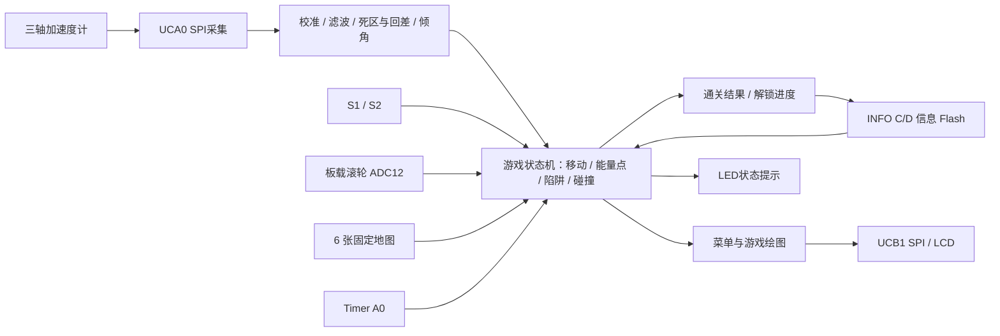

> 返回 [文档索引](README.md)

# 项目概述与设计要点

面向 MSP430F5529 的重力感应迷宫游戏的整体介绍：设计目标、系统分层与指标。具体实现细节分散在各主题文档中，本文只给全貌。

## 1. 项目概述

本项目利用 SEEED-EXP430F5529 V1.0 开发板板载的三轴加速度计、102×64 LCD、两个用户按键和 LED，实现无需外购模块的重力感应迷宫游戏。玩家倾斜开发板控制小球，在收集全部能量点后到达出口。板级实现参考 TI MSP-EXP430F5529 原理图与 HAL，SEEED 版本号与 TI Rev 编号分别记录（见 [硬件资源与引脚映射](hardware_mapping.md)）。

## 2. 系统功能与指标

已实现的功能：

- 传感器采集、水平校准、低通滤波、方向回差、倾角调速；
- 网格移动、碰撞、6 关地图、能量点与陷阱、暂停、重开、选关；
- 计时、步数、最佳成绩、顺序解锁、信息 Flash 断电存档；
- TUNE 灵敏度调试台（滚轮调值）与传感器诊断界面。

板级驱动覆盖早期板卡的 CMA3000-D01、Rev2.2 的 LIS3DH，以及板载模拟拇指轮（ADC12 A5）。

设计目标（**尚未逐项实测，不能当作已测结果**）：20ms 采样、100ms 刷新、90～190ms 随倾角变化的移动间隔、六张固定地图、静置 10s 无误移动、连续运行 30min 无死机。采样、刷新、响应、存档保持和长期稳定性仍需实板测试，方法与清单见 [测试计划](test_plan.md)。

## 3. 系统框图

更细的调度与模块接口见 [系统架构与模块接口](architecture.md)。

## 4. 硬件设计

无新增电路。加速度计使用 UCA0，LCD 使用 UCB1，两条总线独立。S1=P1.7、S2=P2.2、LED1=P1.0，滚轮使能 P8.0、滑臂 P6.5/ADC12 A5。电源和下载通过板载 eZ-FET，系统使用内部 REFO/FLL 时钟。完整引脚表见 [硬件资源与引脚映射](hardware_mapping.md)。

## 5. 软件设计

系统使用 C 语言分层组织：board 初始化、drivers 外设访问、input 校准/方向/灵敏度参数、game 地图与规则、app 状态机、ui 绘图。定时中断维护时基，每 5ms 扫描按键，稳定 20ms 后接受电平变化，通过事件队列交给主循环处理，减少 LCD 刷新期间的漏按。主循环执行传感器采样、游戏和显示，不使用动态内存。

灵敏度不写死在代码里：7 个手感参数集中在 `g_tuning`，可在 TUNE 调试台现场调整并保存到 INFO B；`App_Init` 上电载入并做范围与曲线一致性钳制。调试台用板载模拟拇指轮调值（ADC12 A5，P8.0 使能），实时显示滤波后倾角、计算的每格间隔、方向与倾角条，退出后立即用于游戏。

校准在松开按键后先等待 1 秒，再采集 64 组数据并检查稳定性、Z 轴重力分量和水平姿态；失败区分原因并显示波动值，便于实板调试。等待与采样期间忽略重复短按，避免重新开始。滤波后使用 130mg 触发（约 7.5°）、100mg 释放及轴竞争回差（35mg），控制小球沿单一方向移动；低通权重可调（默认 2/4，TUNE 可调 1/4～3/4），同时把两轴较大值作为倾角，移动间隔在 190～90ms 之间线性变化，倾角越大越快。

游戏层维护 15×9 网格与 6 张地图。每关有 1～4 个能量点，全部收集后出口才可进入；踩到陷阱退回起点并罚时 3 秒；成功移动计一步，通关冻结计时。通关后合并最佳用时/步数并解锁下一关，变化写入 INFO C/D 信息 Flash（双备份 + 校验和，掉电最坏只丢最近一次保存）。菜单显示关卡、最佳成绩、解锁进度与锁定状态。

LCD 使用 816 字节帧缓冲。地图为 15×9 网格，每格 6×6 像素，占据 (6,10) 至 (95,63)；顶部 HUD 显示关卡、步数、能量点与秒数。

状态流转见 [状态机](state_machine.md)，玩法规则与界面见 [游戏玩法与 TUNE 调参](gameplay.md)。

## 6. 已完成验证

主机 GCC 使用 C89 严格编译选项通过行为测试，覆盖地图可达性、路径通关、墙体碰撞、暂停计时、时基回绕、校准稳定性、方向、按键、LCD 帧缓冲、传感器 SPI 模型，以及六关“收集+出口”可解性、陷阱传送/罚时、出口锁定、倾角调速、菜单锁定、存档双槽/校验回退/合并成绩/擦除失败、TUNE 参数范围/曲线/INFO B 保存与损坏回退、应用级滚轮调参与保存流程。实测输出见 [验证记录](validation.md)。

信息 Flash 驱动与滚轮驱动分别通过主机寄存器/ADC 桩的 C89 语法编译，未做实物擦写与 ADC 读数验证。

## 7. 已知限制与待验证项

- **Z 轴幅度异常**：校准时 |Z| 须在 600～1400mg，而实物平放时 Z 仅约 ±162mg，会停在 `CHECK Z / POSTURE`。根因未确定，不做倍率补偿，排查见 [传感器诊断与 Z 轴排查](sensor_diagnostics.md)。
- **方向需实物确认**：当前配置 `MOTION_X_SIGN=-1`、`MOTION_Y_SIGN=1`、`MOTION_SWAP_XY=0`，需在实物上再次确认左右/上下。
- **待上板确认**：CCS 5.5 目标编译与资源占用、INFO B/C/D 的断电保持（通关一关后断电重上电看 `PROGRESS/BEST`，以及 TUNE 参数是否保留）、TUNE 调试台的滚轮读数/转向与按键手感、6 关手感与倾角调速、能量点/陷阱/出口锁定图形显示、游戏方向与 30 分钟连续运行。

## 8. 项目特点

项目结合板载传感器与图形交互，在有限单片机资源内实现完整游戏。工作量集中于输入稳定性、状态管理、关卡设计、存档与边界处理，而非单纯显示图像。实现不涉及精确姿态估计、重力积分、随机地图生成或网络功能；地图为固定常量，进度与纪录使用信息 Flash 保存。

## 9. 仓库内容

CCS 工程元数据、C 源代码、六张固定地图、主机测试（`tests/`、`tools/test_host.ps1`）以及本目录下的全部文档。参考资料与第三方代码声明见 [资料来源与兼容性依据](sources.md) 与根目录 `NOTICE_TI.txt`。
