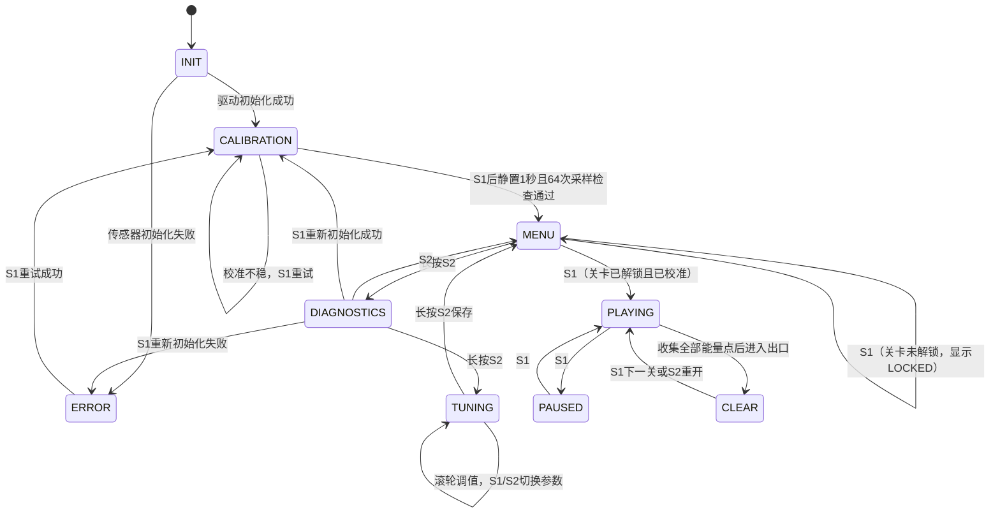

> 返回 [文档索引](README.md)

# 状态机

除错误界面外，长按 S1 进入校准准备，当前局结束；运行、暂停、通关界面长按 S2 返回菜单。校准界面长按 S2 可以提前查看传感器数据；校准未完成时即便返回菜单并开始，仍会转回校准。

所有非 PLAYING 状态均停止游戏计时与移动。重新运行会清除旧的滤波方向，避免暂停前的输入导致立即移动。进入 ERROR 后 S1 重新初始化传感器；成功后重新校准，不直接恢复失效前状态。

校准内部依次为 IDLE → SETTLING（等待 1 秒）→ COLLECTING（64 次有效采样）→ OK 或 UNSTABLE。SETTLING 与 COLLECTING 忽略重复短按 S1，长按 S1 可取消并回到准备。失败后显示具体检查项，短按 S1 才重新开始。长按 S2 可转诊断页。

诊断页短按 S1 会重新初始化；成功清除校准并回到准备页，失败进入 ERROR。长按 S1 仅回校准，不重新初始化传感器。S2 短按或长按均可从诊断返回菜单；**长按 S2 进入 TUNE 灵敏度调试台**。

## TUNE 调试台

- 从诊断页长按 S2 进入；参数顺序 TRIGGER / RELEASE / MARGIN / SLOW / FAST / FULL / FILTER / DEFAULT，S1/S2 短按前后切换。
- **转动板载滚轮调整当前参数**（模拟拇指轮 P6.5/A5、P8.0 使能）；`DEFAULT` 项转一下滚轮或按 S1 短按恢复全部默认值。
- 长按 S2 保存到 INFO B 并返回菜单；长按 S1 不保存返回。保存失败只影响保存，参数仍在本次上电内生效。
- 调试台内实时刷新倾角、计算出的步进间隔和方向，不移动小球、不改变游戏计时；退出后参数立即用于游戏。

## 关卡进度与存档

- 菜单选中未解锁关卡时显示 `LOCKED`，按 S1 不进入 PLAYING；通关第 N 关后解锁第 N+1 关（`GAME_LEVEL_LOCK=0` 时全部可选）。
- 通关时 `Save_ApplyResult()` 合并最佳用时/步数并解锁下一关；有变化才调用 `Save_Store()` 写 INFO Flash，写入的是另一个槽（双备份）。
- `App_Init()` 时 `Save_Load()` 读取两个槽，取校验通过且序号较新的记录，恢复解锁数与各关纪录；无效则使用默认值。存档失败只影响保存，不改变状态机。
- 陷阱与能量点都在 PLAYING 内处理：踩陷阱计一步、加 3 秒罚时并回到起点；能量点未收集完时进入出口被拒绝，不改变状态。

状态编号与 CCS 观察变量 `g_debug.state` 的对应关系（1 校准、2 菜单、3 运行、4 暂停、5 通关、6 错误、7 诊断）见 [首次上板与联调步骤](bringup.md)。
